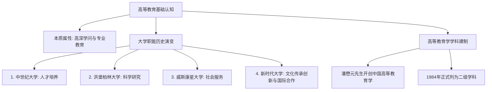

# 第一节 高等教育与高等教育学

## 课程元数据
- **课程门类**：高等教育学（高校教师岗前培训）
- **课时编号**：第一讲
- **核心重点**：高等教育本质属性、现代大学四大职能演进、高等教育学学科建立历程

---

## 一、 本讲思维导图与核心知识脉络

---

## 二、 重点知识与时间轴索引（点击时间戳可直接跳转视频）

### 1. 高等教育的内涵界定 `[00:27]`
- **定义**：建立在完全中等教育基础之上的高深专门学问的传授、研究与应用教育。
- **与普通基础教育的区别**：
  - 培养目标：面向特定行业/学科领域的高级专门人才；
  - 教学内容：探究高深专门知识，具有探索性与学术前沿性。

### 2. 现代大学四大基本职能的演进顺序 `[00:44]`
> 提示：本部分为历年岗培考试的高频单选与简答核心考点。

1. **人才培养（第一职能）** `[00:53]`：
   - 起源于欧洲中世纪大学（如博洛尼亚大学、巴黎大学）；
   - 初衷为神学、法学、医学与哲学的行会式学徒训育。
2. **科学研究（第二职能）** `[01:02]`：
   - 19世纪初由德国教育家**威廉·冯·洪堡**（Wilhelm von Humboldt）创办柏林大学时确立；
   - 提出“**教学与科研相统一**”（Einheit von Lehre und Forschung）及“学术自由”原则。
3. **社会服务（第三职能）** `[01:13]`：
   - 20世纪初由美国**威斯康星大学**查尔斯·范海斯提出著名的“**威斯康星思想**”（Wisconsin Idea）；
   - 理念：“州的边界就是大学的边界”，推动农业推广与技术咨询。
4. **文化传承创新（第四职能）** `[01:24]`：
   - 强调大学是人类先进文化传播、文明互鉴与思想创新的高地。

### 3. 高等教育学作为独立学科的创立与发展 `[01:33]`
- **中国开创者**：以潘懋元教授为代表的一批老一辈学者，推动了高等教育研究从经验上升到专门学问。
- **建制标志**：1984年经国务院学位委员会审议，高等教育学在我国正式确立为教育学门类下的二级学科。

---

## 三、 考点强化与自测思考题

1. **【单选题】** 首次确立“教学与科研相结合”原则、确立大学科学研究职能的大学是（ ）
   - A. 巴黎大学
   - B. 柏林大学 (正确答案)
   - C. 哈佛大学
   - D. 威斯康星大学
2. **【思考题】** 作为高校新入职教师，如何平衡自身教学工作与科研任务之间的关系？结合洪堡精神谈谈你的理解。
